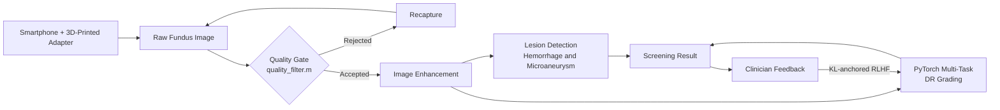

<div align="center">

# NetraSense

### Adaptive Retinal Screening AI & 3D-Printed Hardware

*An end-to-end, low-cost diabetic retinopathy (DR) screening pipeline, from a 3D-printed phone adapter to clinician-in-the-loop AI.*

[Video Demo](https://drive.google.com/file/d/14a7HKVSnaQPbePSgQ4wUk6hhX6Ago4Qr/view?usp=sharing) •
[Demo Images](https://drive.google.com/drive/folders/1maapR4iSoNl-SaP4cdFXWEq9AVurF7XF?usp=sharing) •
[Slides](https://drive.google.com/file/d/1LKeeMtHG5_bl3H-GGnNfFqNwllP864lx/view?usp=sharing)

</div>

---

## Table of Contents
- [Overview](#-overview)
- [Key Features](#-key-features)
- [Pipeline Architecture](#-pipeline-architecture)
- [What We Built](#-what-we-built-during-build-2026)
- [Repository Structure](#-repository-structure)
- [Quick Start](#-quick-start)
- [Demo & Presentation](#-demo--presentation)
- [Team](#-team)

---

## Overview

NetraSense bridges the gap between resource-constrained clinics and specialist-level ophthalmology.

Traditional screening tools tend to fail in one of three ways:

| Problem | Impact |
|---|---|
| Prohibitively expensive equipment | Rural and small clinics can't afford it |
| High scan rejection from poor lighting or blur | Repeat visits and missed screenings |
| Rigid, black-box classifiers | Can't adapt to local clinical feedback |

**NetraSense solves all three** with one modular ecosystem, from the lens to the model.

---

## Key Features

| # | Module | Description |
|---|---|---|
| 1 | **Low-Cost Hardware** | 3D-printed, smartphone-compatible fundus camera adapter (`fundus_camera_complete_assembly.stl`) |
| 2 | **Pre-Diagnostic Quality Gate** | MATLAB optical feature extraction (`quality_filter.m`) validates clarity *before* grading |
| 3 | **Multi-Task Lesion Detection** | MATLAB enhancement and lesion localization for hemorrhages and microaneurysms |
| 4 | **Adaptive ML + RLHF** | PyTorch multi-task DR grading with **KL-anchored clinician RLHF** |

---

## Pipeline Architecture



---

## What We Built During BUILD 2026

### Hardware Prototyping (`.stl`)
Designed and modeled a portable, 3D-printed smartphone fundus camera attachment to cut equipment barriers.

### MATLAB Optical Pipeline (`.m` / `.txt`)

| Script | Purpose |
|---|---|
| `quality_filter.m` | Evaluates **illumination, blur, and contrast** to accept or reject scans |
| `image_enhancement.m.txt` | Enhances retinal vascular visibility |
| `hemorrhage_detection.m.txt` | Rule-based and morphological extraction of hemorrhage regions |
| `microaneurysm_detection.m.txt` | Morphological detection of microaneurysms |

### Machine Learning & RLHF (`.ipynb`)
- PyTorch training pipelines for **multi-task DR grading**
- **KL-divergence anchored RLHF** that updates model weights from clinician corrections while **avoiding catastrophic forgetting**

---

## Repository Structure

```text
├── NetraSense_Presentation.pdf          # Official BUILD 2026 slide deck
├── README.md                            # Project documentation
├── fundus_camera_complete_assembly.stl  # 3D-printable smartphone adapter (CAD)
├── quality_filter.m                     # Image acceptance/rejection quality gate
├── image_enhancement.m.txt              # Preprocessing and contrast enhancement
├── hemorrhage_detection.m.txt           # Hemorrhage lesion extraction
├── microaneurysm_detection.m.txt        # Microaneurysm detection
└── netrasense-hackyard-ml-rlhf.ipynb    # ML training, inference, and RLHF notebook
```

> **Note:** The lesion/enhancement scripts use the `.m.txt` extension. Rename them to `.m` before running them in MATLAB.

---

## Quick Start

### 1. Hardware Assembly
1. Open `fundus_camera_complete_assembly.stl` in any slicer (**PrusaSlicer**, **Cura**).
2. Print with **PLA** filament.
3. Assemble with standard optical lenses and align with your smartphone camera.

### 2. MATLAB Quality & Feature Extraction
1. Open MATLAB and run `quality_filter.m` on your raw fundus images (or the [sample images](https://drive.google.com/drive/folders/1maapR4iSoNl-SaP4cdFXWEq9AVurF7XF?usp=sharing)) to verify usability.
2. Use `image_enhancement.m`, `hemorrhage_detection.m`, and `microaneurysm_detection.m` for preprocessing and lesion extraction.

### 3. ML & RLHF Notebook
Launch Jupyter or Colab:

```bash
jupyter notebook netrasense-hackyard-ml-rlhf.ipynb
```

Run the cells to load models, perform inference, test quality gates, and execute the RLHF weight-adaptation loop.

---

## Demo & Presentation

| Resource | Link |
|---|---|
| Video Demo Walkthrough | [Google Drive](https://drive.google.com/file/d/14a7HKVSnaQPbePSgQ4wUk6hhX6Ago4Qr/view?usp=sharing) |
| Sample Fundus & Result Images | [Google Drive Folder](https://drive.google.com/drive/folders/1maapR4iSoNl-SaP4cdFXWEq9AVurF7XF?usp=sharing) |
| Slide Presentation | [NetraSense_Presentation.pdf](https://drive.google.com/file/d/1LKeeMtHG5_bl3H-GGnNfFqNwllP864lx/view?usp=sharing) |

---

## Team

Developed for **Hackyard BUILD 2026** by **Team OptiQ**.

<div align="center">

*Making retinal screening accessible, one scan at a time.* 

</div>
